# สคริปต์อัดคลิป: อธิบายโค้ดและคณิตศาสตร์ของโปรเจกต์

**วิธีใช้ไฟล์นี้:** เปิดไฟล์นี้ใน VS Code แล้วกด `Ctrl+Shift+V` (Markdown Preview) วางไว้ครึ่งจอ จากนั้นกด `Ctrl` ค้างแล้วคลิกลิงก์ `เปิด ...` ได้เลย VS Code จะเปิดไฟล์โค้ดที่บรรทัดนั้นให้ ส่วนสูตรเป็นรูป PNG พื้นขาวในโฟลเดอร์ [docs/formulas](formulas/) (ความละเอียดสูง) ใช้ไฟล์ไปวางข้างโค้ดตอนตัดต่อได้เลย ไม่ต้องถ่ายภาพหน้าจอ ต้นฉบับ LaTeX ของแต่ละรูปอยู่ใน [formulas/SOURCE.md](formulas/SOURCE.md)
เลขบรรทัดตรวจแล้วกับไฟล์ `src/` และ `examples/` ที่ตรงกันทั้งบนเครื่องคุณและที่ผมใช้ และ `demo/core.py` ตรวจกับฉบับในเครื่องคุณ ถ้าแก้โค้ดภายหลัง เลขบรรทัดอาจเลื่อน ให้เช็กอีกครั้งก่อนอัด

ทุกฉากมีหัวข้อ 5 อย่างเรียงตามนี้

| หัวข้อ | ความหมาย |
|---|---|
| **เปิด** | ไฟล์ที่ต้องเปิด (คลิกลิงก์) |
| **พูด** | บทพูดภาษาไทย อ่านตามได้เลย |
| **สูตร** | สูตรของจริงที่ใช้ในโค้ดตอนนั้น |
| **โค้ด** | โค้ดจริงที่ต้องชี้ให้ดู (คัดลอกจากไฟล์ตรงๆ) |
| **รัน / ต่อไป** | คำสั่งที่ต้องรัน ผลที่ควรเห็น และไฟล์ที่ต้องเปิดต่อ |

เวลาที่ระบุเป็นค่าประมาณ ผมยังไม่ได้จับเวลาอ่านจริง ฉากที่ติดป้าย **[ตัดได้]** ข้ามได้ถ้าคลิปยาวเกิน

---

## ก่อนกดอัด (ทำครั้งเดียว)

1. เปิด VS Code ที่โฟลเดอร์ `svd-stego-watermark` ปิดแท็บอื่นให้หมด ขยายตัวอักษรของ editor (`Ctrl` + `+`) ให้อ่านได้ชัดในวิดีโอ
2. เปิด terminal ใน VS Code ที่โฟลเดอร์หลักของ repo แล้วรัน `pip install -e .` ถ้ายังไม่เคย (ถ้าไม่ได้ติดตั้ง ให้ตั้ง `set PYTHONPATH=src` ก่อน)
3. รัน `python examples/ex7_many_cases.py` หนึ่งรอบ เพื่อเช็กว่าไม่มี error และเลขตรงกับที่เขียนในไฟล์นี้ (ผมรันบนเครื่องผมเท่านั้น ทศนิยมตัวท้ายอาจต่างได้)
4. เช็กว่ามีรูปอยู่ใน `data/images/` (ใช้รูป `249061.jpg`)
5. ทดลองเปิดเดโม `python demo/app.py` ให้ขึ้นแล้วปิดด้วย `Ctrl+C` ล่วงหน้า
6. ตั้ง mode ของจอเป็นแนวนอน แบ่งครึ่ง: ซ้ายคือโค้ด ขวาคือ terminal เก็บไฟล์สคริปต์นี้ไว้บนจออีกใบหรือพิมพ์ออกมาอ่าน ไม่ต้องให้อยู่ในวิดีโอ

---

## ฉาก 0: เปิดตัวและโครงสร้างโปรเจกต์ (ประมาณ 1.5 นาที)

**เปิด:** [README.md](../README.md) แล้วเลื่อนไปที่ส่วนโครงสร้างโฟลเดอร์ (บรรทัดที่ขึ้นต้นด้วย `src/`, `examples/`, `demo/`, `experiments/`)

**พูด:**
> สวัสดีครับ/ค่ะ คลิปนี้อธิบายการทำงานของโค้ดในโปรเจกต์ "Behind the Images" ซึ่งใช้ SVD (Singular Value Decomposition) ทำสองอย่าง อย่างแรกคือ steganography คือซ่อนข้อความไว้ในรูปโดยไม่ให้ดูออก อย่างที่สองคือ watermarking คือฝังเครื่องหมายแสดงความเป็นเจ้าของไว้ในรูป
>
> คลิปนี้จะไม่อธิบายแค่ภาพรวม แต่จะเปิดโค้ดจริงทีละฟังก์ชัน บอกว่าฟังก์ชันนั้นใช้สูตรคณิตศาสตร์อะไร รับอะไรเข้าไป ได้อะไรออกมา แล้วรันให้ดูผลลัพธ์จากข้อมูลตัวอย่างหลายกรณี
>
> โครงสร้างของโปรเจกต์มีสี่ส่วนหลัก โฟลเดอร์ `src/svdmark` เป็นโค้ดหลักที่มีสูตรทั้งหมด โฟลเดอร์ `examples` เป็นสคริปต์เล็กๆ ที่รันโค้ดหลักเพื่อให้เห็นผล โฟลเดอร์ `demo` เป็นเว็บเดโมที่เรียกโค้ดหลักตัวเดียวกัน และโฟลเดอร์ `experiments` เป็นการทดลองกับรูป 400 รูปที่ให้ตัวเลขในรายงาน ทั้งเดโมและการทดลองเรียกฟังก์ชันจาก `src/svdmark` ตัวเดียวกัน จึงไม่มีสูตรชุดที่สอง

**รัน / ต่อไป:** ไม่ต้องรันอะไร ➡ เปิด [src/svdmark/svd_utils.py](../src/svdmark/svd_utils.py) ในฉากถัดไป

---

## ฉาก 1: SVD คืออะไร และโค้ดอยู่ตรงไหน (ประมาณ 3 นาที)

**เปิด:** [src/svdmark/svd_utils.py](../src/svdmark/svd_utils.py) แล้วเลื่อนทีละฟังก์ชัน
- [svd (บรรทัด 13)](../src/svdmark/svd_utils.py#L13)
- [reconstruct (บรรทัด 19)](../src/svdmark/svd_utils.py#L19)
- [energy (บรรทัด 24)](../src/svdmark/svd_utils.py#L24)
- [svd_2x2_by_hand (บรรทัด 29)](../src/svdmark/svd_utils.py#L29)

**พูด (ตอนเปิด `svd`):**
> รูปขาวดำในคอมพิวเตอร์คือเมทริกซ์ แต่ละช่องคือความสว่างของหนึ่งพิกเซล ค่า 0 คือดำ 255 คือขาว SVD แยกเมทริกซ์ `A` ออกเป็นสามก้อน `U`, `Σ` และ `Vᵀ` โดย `Σ` เป็นเมทริกซ์ทแยงมุมที่เก็บตัวเลขที่เรียกว่า singular value เขียนด้วยตัว σ (ซิกมา) เรียงจากมากไปน้อย
>
> อีกมุมหนึ่งคือ SVD แยกเมทริกซ์เป็นชั้นๆ ซ้อนกัน ชั้นแรกใช้ σ₁ ซึ่งใหญ่ที่สุด ชั้นถัดไปใช้ σ₂ ไปเรื่อยๆ ยิ่ง σ ใหญ่ ชั้นนั้นยิ่งมีผลต่อรูปมาก บรรทัดนี้เรียก `np.linalg.svd` ของ numpy โดยตรง แล้วคืนค่า `U`, `s` (คือ σ ทั้งหมด) และ `Vt`

**สูตร:**


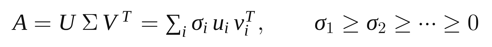


**โค้ด (บรรทัด 13–21):**
```python
def svd(A):
    A = np.asarray(A, dtype=float)
    return np.linalg.svd(A, full_matrices=False)

def reconstruct(U, s, Vt):
    return (U * s) @ Vt
```

**พูด (ตอนเลื่อนไป `reconstruct` และ `energy`):**
> `reconstruct` ทำตรงข้าม คือเอาสามก้อนมาประกอบกลับเป็นเมทริกซ์ `U` คูณ σ คูณ `Vᵀ` ส่วน `energy` คือผลรวมของ σ ยกกำลังสอง ซึ่งเท่ากับผลรวมของทุกช่องในเมทริกซ์ยกกำลังสอง เราใช้ตรวจว่าการแยกไม่ทำให้ข้อมูลหายไป

**สูตร:** 

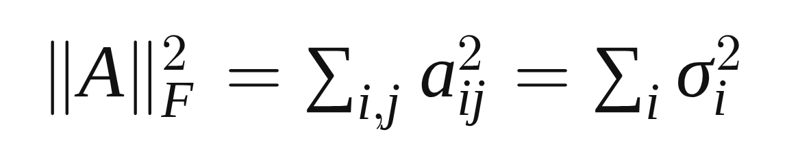


**พูด (ตอนเลื่อนไป `svd_2x2_by_hand`):**
> ฟังก์ชันนี้คำนวณ SVD ของเมทริกซ์ 2×2 ด้วยมือ ตามขั้นตอนในรายงาน เพื่อพิสูจน์ว่า numpy ไม่ได้ทำอะไรลึกลับ วิธีคือหา eigenvalue (ค่าเฉพาะ) λ ของ `AᵀA` แล้ว σ เท่ากับรากที่สองของ λ

**สูตร:** 

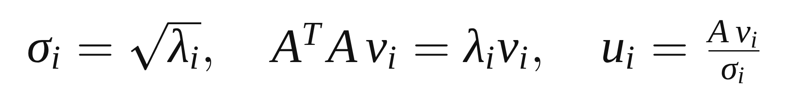


**รัน:** เปิด terminal แล้วรัน `python examples/ex2_svd_2x2.py` (โค้ดของสคริปต์: [examples/ex2_svd_2x2.py](../examples/ex2_svd_2x2.py))

**ผลที่ควรเห็น:**
```
A^T A = [[25. 20.] [20. 25.]]
eigenvalues of A^T A = [45.  5.]
by hand: sigma = [6.7082 2.2361]
numpy:   sigma = [6.7082 2.2361]
|A|_F^2 = 50.0   sigma1^2 + sigma2^2 = 50.0
```

**พูด (ชี้ผล):**
> เมทริกซ์ตัวอย่างคือ `[[3, 0], [4, 5]]` `AᵀA` ได้ 25, 20, 20, 25 ซึ่งมี eigenvalue 45 กับ 5 รากที่สองคือ 6.7082 กับ 2.2361 ตรงกับที่ numpy ให้ และ σ₁ กำลังสองบวก σ₂ กำลังสองเท่ากับ 50 ซึ่งเท่ากับ 3² + 4² + 5² พอดี

**ต่อไป:** ➡ เปิด [src/svdmark/metrics.py](../src/svdmark/metrics.py)

---

## ฉาก 2: ตัววัด NCC, PSNR, BER (ประมาณ 2 นาที)

**เปิด:** [src/svdmark/metrics.py](../src/svdmark/metrics.py)
- [mse (8)](../src/svdmark/metrics.py#L8) · [psnr (18)](../src/svdmark/metrics.py#L18) · [ncc (24)](../src/svdmark/metrics.py#L24) · [ber (43)](../src/svdmark/metrics.py#L43)

**พูด:**
> ก่อนดูการซ่อนข้อความ ต้องรู้ตัววัดสามตัวที่ใช้ตลอดทั้งโปรเจกต์ ตัวแรก PSNR วัดว่ารูปหลังซ่อนข้อความต่างจากรูปเดิมแค่ไหน หน่วยเป็น dB ยิ่งสูงยิ่งใกล้รูปเดิม ประมาณ 40 dB ขึ้นไปตาเปล่าแทบดูไม่ออก คำนวณจาก MSE ซึ่งคือค่าเฉลี่ยของความต่างกำลังสองของทุกพิกเซล
>
> ตัวที่สอง NCC วัดว่าลายน้ำที่ถอดออกมาหน้าตาเหมือนลายน้ำเดิมแค่ไหน คิดจาก dot product หารด้วยความยาวของเวกเตอร์ทั้งสอง ได้ 1 ถ้าเหมือนกันเป๊ะ ได้ 0 ถ้าไม่เกี่ยวกัน ตัวที่สาม BER คือสัดส่วน bit ที่อ่านผิดต่อ bit ทั้งหมด

**สูตร:**


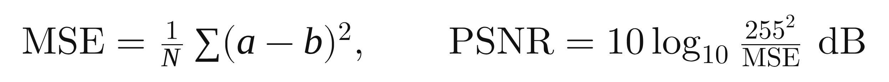


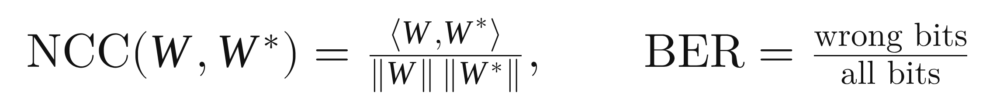


**โค้ด (บรรทัด 18–29):**
```python
def psnr(a, b, peak=255.0):
    m = mse(a, b)
    return float("inf") if m == 0 else float(10.0 * np.log10(peak * peak / m))

def ncc(w, w_hat):
    w = np.asarray(w, dtype=float).ravel()
    w_hat = np.asarray(w_hat, dtype=float).ravel()
    denom = np.linalg.norm(w) * np.linalg.norm(w_hat)
    return float(w @ w_hat / denom) if denom else 0.0
```

**รัน:** `python examples/ex1_vectors.py` (โค้ด: [examples/ex1_vectors.py](../examples/ex1_vectors.py))

**ผลที่ควรเห็น:**
```
|(1,1,1)|          = 1.7321
<W, W*>            = 2
NCC(W, W*)         = 0.632
a + b (mod 2)      = [0 1 1 0]
```

**พูด (ชี้ผล):**
> ตัวอย่าง `W` เป็นโลโก้ 3×3 กับ `W*` ที่เสียหาย dot product คือ 2 ความยาวคือ √5 กับ √2 NCC จึงเป็น 2 หารด้วย √10 ได้ 0.632 บรรทัดสุดท้ายคือการบวก bit แบบ mod 2 คือ 1 บวก 1 ได้ 0 ซึ่งจะกลับมาใช้ใน Hamming code

**ต่อไป:** ➡ เปิด [src/svdmark/stego.py](../src/svdmark/stego.py) บรรทัด 33

---

## ฉาก 3: กฎซ่อน 1 bit ใน σ₁ (QIM) (ประมาณ 4 นาที)

**เปิด:**
- [extract_bit (บรรทัด 33)](../src/svdmark/stego.py#L33)
- [embed_value (บรรทัด 38)](../src/svdmark/stego.py#L38)

**พูด (ภาพรวม):**
> หัวใจของการซ่อนข้อความคือกฎข้อเดียว เอาแกนของ σ มาแบ่งเป็นช่วงกว้างเท่ากัน ความกว้างนี้เรียกว่า Δ (เดลตา) นับช่วงเป็น 0, 1, 2, 3 ... ช่วงที่เลขคู่แทน bit 0 ช่วงที่เลขคี่แทน bit 1 ตัวเลขช่วงหาได้จาก σ หาร Δ แล้วปัดลง เรียกว่า q
>
> ตอนอ่าน แค่ดูว่า σ ตกในช่วงเลขอะไร แล้วดูว่าเป็นคู่หรือคี่ ตอนเขียน ถ้า σ อยู่ในช่วงที่มี parity ไม่ตรงกับ bit ที่ต้องการ ก็ขยับ σ ไปอยู่ตรงกลางของช่วงข้างเคียงที่ parity ถูก โดยเลือกช่วงที่ใกล้กว่า

**สูตร:**


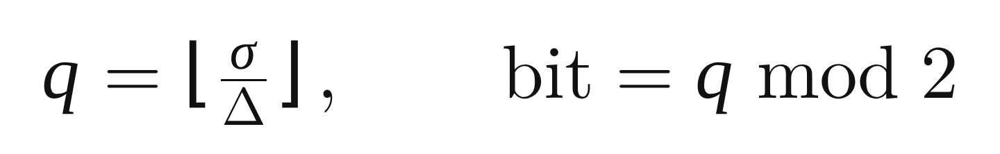


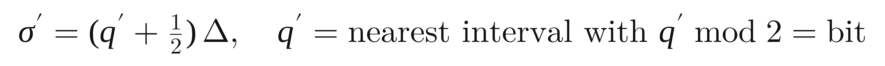


**โค้ด (บรรทัด 33–50):**
```python
def extract_bit(sigma: float, delta: float) -> int:
    return int(np.floor(sigma / delta)) % 2

def embed_value(sigma: float, bit: int, delta: float) -> float:
    q = int(np.floor(sigma / delta))
    if q % 2 != bit:
        up, down = q + 1, q - 1
        if down < 0 or abs((up + 0.5) * delta - sigma) <= abs((down + 0.5) * delta - sigma):
            q = up
        else:
            q = down
    return (q + 0.5) * delta
```

**พูด (ตอนชี้โค้ด):**
> `extract_bit` มีบรรทัดเดียว หาร ปัดลง แล้ว mod 2 ส่วน `embed_value` ถ้า parity ตรงอยู่แล้วก็ใช้ช่วงเดิม ถ้าไม่ตรง ลองช่วงบน (`up`) กับช่วงล่าง (`down`) เลือกอันที่จุดกึ่งกลางอยู่ใกล้ σ มากกว่า และไม่ลงไปต่ำกว่า 0 สาเหตุที่ย้ายไปกึ่งกลางช่วงคือเผื่อพื้นที่ไว้ ถ้า σ ถูกรบกวนให้ขยับไม่เกินครึ่งหนึ่งของ Δ ทั้งสองทาง ก็ยังอ่านได้ bit เดิม

**รัน:** `python examples/ex3_qim_block.py` (โค้ด: [examples/ex3_qim_block.py](../examples/ex3_qim_block.py))

**ผลที่ควรเห็น:**
```
sigma            = [113.687   2.524]
bit now          = 0 (interval 18)
new sigma1       = 117.0
B' (before round)= [[53.55 56.56] [62.74 60.75]]
B' (rounded)     = [[54. 57.] [63. 61.]]
receiver sigma1  = 117.68  -> bit 1
PSNR             = 42.11 dB
```

**พูด (ชี้ผล):**
> ตัวอย่างนี้เป็น block 2×2 ใช้ Δ เท่ากับ 6 เพื่อให้ตัวเลขเล็กอ่านง่าย σ₁ ตอนแรกคือ 113.687 อยู่ในช่วงที่ 18 ซึ่งเป็นเลขคู่ จึงเก็บ bit 0 แต่เราต้องการซ่อน bit 1 ช่วงข้างเคียงคือช่วง 17 กับช่วง 19 จุดกึ่งกลางคือ 105 กับ 117 อันหลังใกล้กว่า จึงย้าย σ₁ ไป 117.0
>
> จุดสำคัญอยู่บรรทัดถัดมา พอประกอบ block กลับ ได้เลขทศนิยม แต่รูปจริงเก็บเป็นจำนวนเต็ม จึงต้องปัดเศษ พอปัดแล้วผู้รับวัด σ₁ ใหม่ได้ 117.68 ไม่ใช่ 117.0 พอดี แต่ยังอยู่ในช่วง 19 ซึ่งเป็นเลขคี่ จึงอ่านได้ bit 1 ถูกต้อง นี่คือเหตุผลที่โปรเจกต์ใช้ Δ ใหญ่กว่าขนาด block และตรวจซ้ำหลังปัดเศษ ซึ่งจะอธิบายในฉากถัดไป

**ต่อไป:** ➡ เลื่อนใน [stego.py](../src/svdmark/stego.py) ไปที่ `to_blocks` บรรทัด 54 แล้วต่อด้วย `embed_bits` บรรทัด 113

---

## ฉาก 4: ซ่อนทั้งรูปทีละ block และ closed-loop check (ประมาณ 5 นาที)

**เปิด:**
- [to_blocks (54)](../src/svdmark/stego.py#L54) · [capacity (66)](../src/svdmark/stego.py#L66)
- [embed_bits (113)](../src/svdmark/stego.py#L113)

**พูด (to_blocks และ capacity):**
> ตัวอย่างเมื่อกี้ใช้ block เดียว ของจริงต้องซ่อนข้อความยาวๆ จึงตัดรูปเป็น block สี่เหลี่ยมขนาด `b` คูณ `b` เรียงตามลำดับการอ่านหนังสือ แต่ละ block ซ่อนได้ 1 bit ในโหมด Balanced ใช้ `b` เท่ากับ 8 และ Δ เท่ากับ 32 ความจุของรูปจึงเท่ากับจำนวน block คือความสูงหาร `b` คูณความกว้างหาร `b` รูปตัวอย่างขนาด 480×320 มี 60 คูณ 40 เท่ากับ 2,400 block ใส่ข้อความได้ 296 bytes

**สูตร:** 

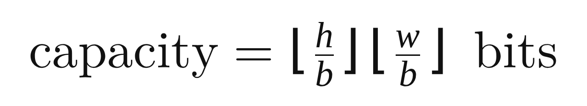


**พูด (embed_bits เริ่มต้น):** เลื่อนไปบรรทัด 156–158
> ฟังก์ชัน `embed_bits` คือหัวใจของฝั่งซ่อนข้อความ ขั้นแรกบรรทัด 157 ทำ SVD ของทุก block พร้อมกัน แล้วบรรทัด 158 เอา σ ตัวที่ k ออกมา ค่าปริยายคือ k เท่ากับ 0 คือ σ₁ เหตุผลที่เลือก σ₁ คือมันใหญ่ที่สุด ขยับนิดเดียวเมื่อเทียบกับตัวมันเอง รูปจึงแทบไม่เปลี่ยน และทนการรบกวนได้ดี

**โค้ด (บรรทัด 156–164):**
```python
sel = blocks[:n]  # view: blocks that carry a bit (the first n, raster order)
U, s, Vt = np.linalg.svd(sel)
sk = s[:, k]
u = _dither(n, delta, key)
q = np.floor((sk - u) / delta)[:, None] + np.arange(-search, search + 1)
centre = u[:, None] + (q + 0.5) * delta
valid = (centre > 0) & (q % 2 == bits[:, None])
dist = np.where(valid, np.abs(centre - sk[:, None]), np.inf)
order = np.argsort(dist, axis=1, kind="stable")
```

**พูด (บรรทัด 159–164):**
> บรรทัด 159 คือค่าเลื่อนลับ `u` จาก key ซึ่งจะอธิบายในฉากถัดไป ถ้าไม่ใส่ key ค่านี้เป็นศูนย์ บรรทัด 160–161 ไม่ได้ลองแค่ช่วงข้างเคียงสองช่วง แต่สร้างตัวเลือกช่วงรอบๆ σ ตั้งแต่ลบ 3 ถึงบวก 3 ช่วง บรรทัด 162 เก็บเฉพาะตัวเลือกที่ parity ตรงกับ bit ที่ต้องการและจุดกึ่งกลางมากกว่า 0 บรรทัด 163–164 เรียงตัวเลือกตามระยะห่างจาก σ เดิม ตัวที่ใกล้ที่สุดมาก่อน เพราะยิ่งขยับน้อย รูปยิ่งเปลี่ยนน้อย

**พูด (บรรทัด 175–181 ส่วน rebuild และ read-back):**
> ต่อมาเป็นส่วนที่ต่างจากตัวอย่างเล็กๆ คือ closed-loop check บรรทัด 175–176 ใส่ σ ใหม่เข้าไป บรรทัด 177 ประกอบ block กลับ แล้วปัดเป็นจำนวนเต็ม 0 ถึง 255 เหมือนที่รูปจริงเก็บ บรรทัด 178 ทำ SVD ใหม่ของ block ที่ปัดแล้ว เพื่ออ่าน σ กลับมาเหมือนที่ผู้รับจะอ่าน บรรทัด 179 อ่าน bit จาก σ ที่ได้

**โค้ด (บรรทัด 175–181):**
```python
s_new = s[pend].copy()
s_new[:, k] = np.where(ok_cand, centre[pend, col], s_new[:, k])
blk = np.clip(np.rint((U[pend] * s_new[:, None, :]) @ Vt[pend]), 0, 255)
s_read = np.linalg.svd(blk, compute_uv=False)[:, k]
read = extract_bit_array(s_read, delta, u[pend])
pos = ((s_read - u[pend]) / delta) % 1.0
mg = np.minimum(pos, 1.0 - pos)
```

**สูตร (margin ของ closed-loop):**


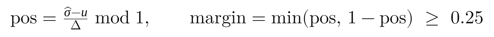


**พูด (บรรทัด 180–188 ส่วนยอมรับหรือปฏิเสธ):**
> บรรทัด 180–181 คำนวณว่า σ ที่อ่านกลับห่างจากขอบช่วงแค่ไหน นับเป็นสัดส่วนของ Δ ถ้า σ ตกใกล้ขอบมาก JPEG นิดเดียวก็พลิก bit ได้ จึงมีเงื่อนไขบรรทัด 186 ว่ายอมรับตัวเลือกนี้ก็ต่อเมื่ออ่านถูกและ margin อย่างน้อย 0.25 คือ σ ต้องตกอยู่ในครึ่งกลางของช่วง ถ้าตัวเลือกแรกไม่ผ่าน วนไปลองตัวเลือกถัดไปที่ไกลขึ้น
>
> ถ้าทุกตัวเลือกไม่ผ่านเงื่อนไข margin บรรทัด 189–192 เลือกตัวที่อ่านถูกและ margin ดีที่สุด แล้วบันทึกว่าเป็น `weak` ถ้าไม่มีตัวไหนอ่านถูกเลย block นั้นถูกปล่อยไว้เหมือนเดิมและนับเป็น `failed` ผลลัพธ์คืนมาในรูป `StegoResult` ซึ่งบอกจำนวน failed และ weak

**โค้ด (บรรทัด 182–193):**
```python
right = ok_cand & (read == bits[pend])
better = right & (mg > best_mg[pend])
best_blk[pend[better]] = blk[better]
best_mg[pend[better]] = mg[better]
good = right & (mg >= margin)
sel[pend[good]] = blk[good]
done[pend[good]] = True
...
rest = np.flatnonzero(~done & (best_mg >= 0))  # pass 2
sel[rest] = best_blk[rest]
weak[rest] = True
done[rest] = True
return StegoResult(from_blocks(blocks, A.shape, b), n, ~done, weak)
```

**ต่อไป:** ➡ เลื่อนไป [extract_bits (บรรทัด 201)](../src/svdmark/stego.py#L201)

---

## ฉาก 5: ฝั่งอ่าน และ key ลับ (ประมาณ 3 นาที)

**เปิด:**
- [extract_bits (201)](../src/svdmark/stego.py#L201) · [extract_bit_array (196)](../src/svdmark/stego.py#L196)
- [_key_seed (92)](../src/svdmark/stego.py#L92) · [_dither (102)](../src/svdmark/stego.py#L102)

**พูด (extract_bits):**
> ฝั่งอ่านสั้นกว่ามาก บรรทัด 212 ตัดรูปเป็น block เหมือนเดิม ทำ SVD ของ block แรกๆ ตามจำนวน bit ที่ต้องอ่าน เอา σ ตัวที่ k ออกมา แล้วบรรทัด 213 ใช้กฎ parity เดิม ผู้รับไม่ต้องใช้รูปต้นฉบับเลย ใช้แค่รูปที่ได้รับ ขนาด block Δ และ key

**โค้ด (บรรทัด 196–213 ส่วนสำคัญ):**
```python
def extract_bit_array(sigma, delta, offset=0.0):
    return (np.floor((np.asarray(sigma, dtype=float) - offset) / delta) % 2).astype(int)
...
sig = np.linalg.svd(to_blocks(A, b)[:n_bits], compute_uv=False)
return extract_bit_array(sig[:, k], delta, _dither(n_bits, delta, key))
```

**พูด (_key_seed และ _dither):**
> key ลับทำงานโดยเลื่อนตารางช่วงของแต่ละ block ไม่เท่ากัน เริ่มจากบรรทัด 92 แปลงรหัสผ่านเป็นตัวเลขขนาดใหญ่ 256 bit ด้วย PBKDF2-HMAC-SHA256 ซึ่งเป็นฟังก์ชันที่ตั้งใจให้ช้า ทำซ้ำ 200,000 รอบ เพื่อให้การเดารหัสผ่านทีละตัวใช้เวลานาน จากนั้นบรรทัด 102 ใช้ตัวเลขนั้นสุ่มค่าเลื่อน `u` ระหว่าง 0 ถึง 2Δ ให้แต่ละ block คนละค่า
>
> ผลคือ ถ้าไม่มี key ตำแหน่ง σ หาร Δ ของทุก block จะดูกระจายเท่ากัน ไม่กองอยู่ตรงกลางช่วง ซึ่งเป็นรอยให้จับได้ และถ้าอ่านด้วย key ผิด ค่าเลื่อนผิดทุก block bit ที่อ่านได้จะผิดไปประมาณครึ่งหนึ่ง

**สูตร:** 

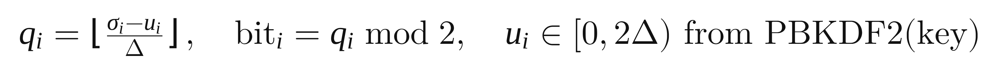


**โค้ด (บรรทัด 92–110):**
```python
def _key_seed(key: str) -> int:
    return int.from_bytes(hashlib.pbkdf2_hmac("sha256", key.encode("utf-8"), KDF_SALT, KDF_ITERATIONS), "big")

def _dither(n, delta, key):
    if key is None:
        return np.zeros(n)
    return np.random.default_rng(_key_seed(str(key))).uniform(0.0, 2.0 * delta, n)
```

**ต่อไป:** ➡ เลื่อนใน [stego.py](../src/svdmark/stego.py) ไปส่วนข้อความ บรรทัด 224

---

## ฉาก 6: จากข้อความเป็น bit, CRC และสถานะผลอ่าน (ประมาณ 3 นาที)

**เปิด:**
- [text_to_bits (244)](../src/svdmark/stego.py#L244) · [_crc (240)](../src/svdmark/stego.py#L240)
- [bits_to_text (266)](../src/svdmark/stego.py#L266)
- [embed_text (290)](../src/svdmark/stego.py#L290) · [extract_text (327)](../src/svdmark/stego.py#L327)

**พูด:**
> ข้อความภาษาไทยต้องเปลี่ยนเป็น bit ก่อน ฟังก์ชัน `text_to_bits` แปลงข้อความเป็น UTF-8 แล้วต่อหน้าด้วยหัว 32 bit ครึ่งแรก 16 bit บอกความยาวของข้อความเป็น bytes ครึ่งหลัง 16 bit คือ CRC
>
> CRC (Cyclic Redundancy Check) คือเลขตรวจที่คำนวณจากความยาวและข้อความ ผู้รับคำนวณ CRC จากข้อความที่อ่านได้ใหม่ แล้วเทียบกับ CRC ที่ซ่อนมา ถ้าไม่ตรงแปลว่ามี bit ผิด เราจึงรู้ว่าข้อความเสียหาย ไม่ต้องเดา

**สูตร:** 

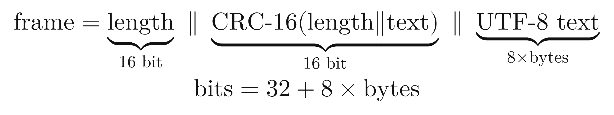


**โค้ด (บรรทัด 240–251):**
```python
def _crc(length_field: bytes, payload: bytes) -> int:
    return binascii.crc_hqx(length_field + payload, CRC_INIT)

def text_to_bits(text: str) -> np.ndarray:
    payload = text.encode("utf-8")
    ...
    length_field = len(payload).to_bytes(2, "big")
    return bytes_to_bits(length_field + _crc(length_field, payload).to_bytes(2, "big") + payload)
```

**พูด (bits_to_text):**
> ฝั่งผู้รับ `bits_to_text` อ่านหัว 32 bit ก่อน แล้วคืนสถานะสามแบบ สถานะ `ok` คือความยาวสมเหตุสมผลและ CRC ตรง ข้อความที่ได้ถูกต้องทุกตัวอักษร สถานะ `damaged` คือความยาวพอดีแต่ CRC ไม่ตรง แปลว่ามี bit ผิด สถานะ `no_message` คือหัวไม่สมเหตุสมผล เช่น ความยาวเป็น 0 หรือยาวเกินรูป ซึ่งเกิดเมื่อรูปไม่เคยซ่อนอะไร หรือ key ผิด

**พูด (embed_text และ extract_text):**
> `embed_text` รวมทุกอย่างที่ผ่านมา ตรวจความจุก่อน ถ้าเกินจะแจ้ง error บอกเหตุผล แล้วแปลงข้อความเป็น bit ถ้าเปิด ECC ก็ผ่าน Hamming code (ฉากถัดไป) แล้วเรียก `embed_bits` ส่วน `extract_text` อ่านหัวก่อนเพื่อรู้ความยาว แล้วอ่านเฉพาะจำนวน bit ที่ต้องใช้ ไม่ต้องอ่านทั้งรูป

**รัน:** `python examples/ex6_hide_text.py` (โค้ด: [examples/ex6_hide_text.py](../examples/ex6_hide_text.py))

**ผลที่ควรเห็น:**
```
image matrix      : (320, 480)  capacity 296 bytes
PSNR              : 47.69 dB, 0 failed blocks
right key         : ('นัดเจอหน้าตึก ECC 5 โมง', 'ok')
wrong key         : (None, 'no_message')
right key, JPEG90 : ('นัดเจอหน้าตึก ECC 5 โมง', 'ok')
```

**พูด (ชี้ผล):**
> รูปขนาด 480×320 จุได้ 296 bytes ซ่อนข้อความสั้นๆ แล้วได้ PSNR 47.69 dB เพราะข้อความสั้นแก้แค่ส่วนบนของรูป ถ้าข้อความเต็มรูปจะได้ราว 41 dB ค่าเฉลี่ยจาก 400 รูปในรายงานคือ 40.7 dB อ่านด้วย key ถูกได้ข้อความครบ สถานะ `ok` อ่านด้วย key ผิดได้ `no_message` และเมื่อบันทึกเป็น JPEG คุณภาพ 90 ก็ยังอ่านได้ครบ

**ต่อไป:** ➡ เปิด [src/svdmark/ecc.py](../src/svdmark/ecc.py)

---

## ฉาก 7: Hamming(7,4) แก้ bit ที่ผิด (ประมาณ 3 นาที) **[ตัดได้]**

**เปิด:** [src/svdmark/ecc.py](../src/svdmark/ecc.py)
- [P, G, H (19–21)](../src/svdmark/ecc.py#L19) · [encode (36)](../src/svdmark/ecc.py#L36) · [decode (43)](../src/svdmark/ecc.py#L43)

**พูด:**
> CRC บอกได้แค่ว่ามี bit ผิด แต่แก้ให้ไม่ได้ ถ้า bit เดียวผิดทั้งข้อความก็ใช้ไม่ได้ Hamming(7,4) แก้ปัญหานี้ โดยเพิ่ม bit ตรวจ 3 ตัวต่อทุก 4 bit ข้อมูล รวมเป็น 7 bit ต่อหนึ่ง codeword ผลคือแก้ bit ที่ผิด 1 ตัวต่อ 7 bit ได้ แลกกับการที่ความจุเหลือ 4 ใน 7 ส่วน
>
> การทำงานเป็นพีชคณิตเชิงเส้นบน bit คือคูณเมทริกซ์แล้วเอา mod 2 ตอนเข้ารหัสเอาข้อมูล `d` คูณเมทริกซ์ `G` ตอนตรวจเอา codeword ที่ได้รับ `r` คูณ `Hᵀ` ได้เลข 3 bit เรียกว่า syndrome ถ้า syndrome เป็นศูนย์แปลงว่าไม่มี bit ผิด ถ้าไม่ใช่ศูนย์ มันจะเท่ากับคอลัมน์ใดคอลัมน์หนึ่งของ `H` ซึ่งบอกว่า bit ตำแหน่งนั้นผิด ให้พลิกกลับ

**สูตร:**


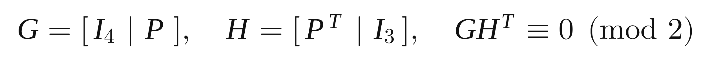


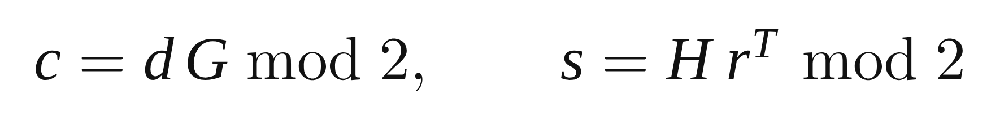


**โค้ด (บรรทัด 19–24 และ 36–53):**
```python
P = np.array([[1, 1, 0], [1, 0, 1], [0, 1, 1], [1, 1, 1]], dtype=np.uint8)
G = np.hstack([np.eye(4, dtype=np.uint8), P])
H = np.hstack([P.T, np.eye(3, dtype=np.uint8)])
...
def encode(bits):
    ...
    return (d @ G % 2).astype(int).ravel()

def decode(bits):
    ...
    s = (r @ H.T) % 2
    syn = s[:, 0] * 4 + s[:, 1] * 2 + s[:, 2]
    for i in np.flatnonzero(syn):
        r[i, _SYN_TO_POS[int(syn[i])]] ^= 1
```

**รัน:** `python examples/ex5_hamming.py` (โค้ด: [examples/ex5_hamming.py](../examples/ex5_hamming.py))

**ผลที่ควรเห็น:**
```
G H^T (mod 2) = [[0 0 0] [0 0 0] [0 0 0] [0 0 0]]
data d        = [1 0 1 1]
codeword c    = [1 0 1 1 0 1 0]
received r    = [1 0 0 1 0 1 0]
syndrome H r  = [0 1 1]  = column 3 of H: [0 1 1]
decoded       = [1 0 1 1]  bits corrected: 1
```

**พูด (ชี้ผล):**
> บรรทัดแรกพิสูจน์ว่า `G` คูณ `Hᵀ` ได้ศูนย์ทั้งหมด ข้อมูล `[1 0 1 1]` เข้ารหัสได้ `[1 0 1 1 0 1 0]` ซึ่งสี่ตัวแรกคือข้อมูลเดิม สามตัวหลังคือ bit ตรวจ แล้วจงใจพลิก bit ตัวที่ 3 ได้ `[1 0 0 1 0 1 0]` syndrome ที่คำนวณได้คือ `[0 1 1]` ตรงกับคอลัมน์ที่ 3 ของ `H` พอดี จึงรู้ว่า bit ตัวที่ 3 ผิด พลิกกลับแล้วได้ข้อมูลเดิม แก้ไป 1 bit

**ต่อไป:** ➡ เปิด [src/svdmark/watermark.py](../src/svdmark/watermark.py)

---

## ฉาก 8: ลายน้ำ Liu–Tan และคะแนน shift (ประมาณ 5 นาที)

**เปิด:** [src/svdmark/watermark.py](../src/svdmark/watermark.py)
- [embed (27)](../src/svdmark/watermark.py#L27) · [extract_from_sigma (43)](../src/svdmark/watermark.py#L43) · [extract (49)](../src/svdmark/watermark.py#L49)
- [shift_score (54)](../src/svdmark/watermark.py#L54) · [shift_from_sigma (66)](../src/svdmark/watermark.py#L66)

**พูด (embed):**
> ลายน้ำใช้วิธีของ Liu และ Tan ปี 2002 ซึ่งต่างจากการซ่อนข้อความ ที่นี่เราฝังทั้งรูปโลโก้ `W` ไม่ใช่ทีละ bit ขั้นแรกทำ SVD ของรูป `A` ได้ `U`, `S`, `Vᵀ` ขั้นสองเอาโลโก้คูณ α (แอลฟา) ซึ่งคือความเข้มของลายน้ำ แล้วบวกเข้ากับ `S` ได้เมทริกซ์ `D` ขั้นสามทำ SVD ของ `D` อีกรอบ ได้ `Uw`, `Sw`, `Vwᵀ` ขั้นสุดท้ายประกอบรูปที่มีลายน้ำจาก `U` เดิม `Sw` ใหม่ และ `Vᵀ` เดิม
>
> สิ่งที่ต้องเก็บไว้ถอดภายหลังคือ key ซึ่งมี `U`, `Vᵀ`, `S`, `Uw`, `Vwᵀ`, α และ `Sw` ในโค้ดคือคลาส `WatermarkKey`

**สูตร:**


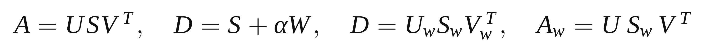


**โค้ด (บรรทัด 27–36):**
```python
def embed(A, W, alpha):
    U, s, Vt = svd(A)
    k = len(s)
    ...
    D = np.diag(s) + alpha * np.asarray(W, dtype=float)
    Uw, sw, Vwt = svd(D)
    Aw = reconstruct(U, sw, Vt)
    return Aw, WatermarkKey(U, Vt, s, Uw, Vwt, alpha, sw)
```

**พูด (extract):**
> ตอนถอด เอารูปที่ได้รับมาทำ SVD เอาเฉพาะ σ ที่ได้ เรียกว่า σ ดาว (σ*) แล้วสร้าง `D*` ใหม่จาก `Uw` คูณ σ* คูณ `Vwᵀ` ลบ `S` เดิมออก แล้วหารด้วย α ได้โลโก้ที่ประมาณได้ `W*`

**สูตร:** 

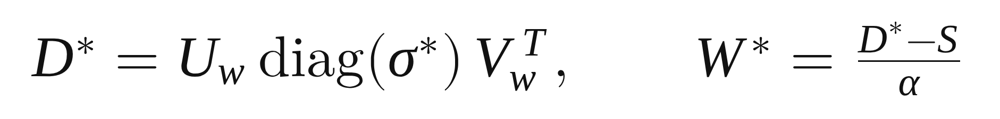


**โค้ด (บรรทัด 43–51):**
```python
def extract_from_sigma(s_star, key):
    D_star = reconstruct(key.Uw, s_star, key.Vwt)
    return (D_star - np.diag(key.S)) / key.alpha

def extract(A_attacked, key):
    return extract_from_sigma(singular_values(A_attacked), key)
```

**พูด (shift_score):**
> ปัญหาคือ NCC ของโลโก้ที่ถอดได้ไม่พอ เพราะโครงของโลโก้ถูกเก็บอยู่ใน key (`Uw` กับ `Vwᵀ`) แล้ว ต่อให้เอารูปที่ไม่เคยฝังลายน้ำมาถอด ก็ยังได้โลโก้ขึ้นมา และ NCC สูงด้วย เราจึงเพิ่มคะแนนอีกตัวชื่อ shift ซึ่งถามว่า σ ของรูปที่ได้รับ ขยับไปจาก σ เดิมในทิศทางเดียวกับที่การฝังขยับหรือไม่ วัดด้วย cosine ระหว่างเวกเตอร์สองตัว ได้ใกล้ 1 ถ้ารูปมีลายน้ำ และได้ 0 ถ้ารูปไม่เคยถูกแตะ

**สูตร:** 

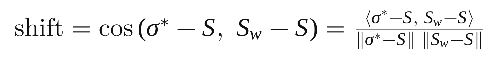


**โค้ด (บรรทัด 66–71):**
```python
def shift_from_sigma(s_star, key):
    v, t = s_star - key.S, key.Sw - key.S
    if np.linalg.norm(v) < 1e-9 * np.linalg.norm(key.S):
        return 0.0
    denom = np.linalg.norm(v) * np.linalg.norm(t)
    return float(v @ t / denom) if denom else 0.0
```

**รัน:** `python examples/ex4_watermark.py` (โค้ด: [examples/ex4_watermark.py](../examples/ex4_watermark.py))

**ผลที่ควรเห็น:**
```
Sigma_w          = [7.2284 2.7284]
|A_w - A|_F      = 0.71626   |sigma_w - sigma| = 0.71626
W* from A_w      = [[1. 0.] [1. 1.]]
3x3 never marked: W*[1,3] = 0.9996  NCC = 0.632  shift = 0.0
3x3 marked:       NCC = 1.0  shift = 1.0
```

**พูด (ชี้ผล):**
> ตัวอย่างแรกเป็นเมทริกซ์ 2×2 ลายน้ำ `[[1,0],[1,1]]` และ α เท่ากับ 0.5 ถอดจากรูปที่ฝังแล้วได้ `[[1,0],[1,1]]` กลับมาเป๊ะ บรรทัดที่สองแสดงว่าขนาดการเปลี่ยนของรูปเท่ากับขนาดการเปลี่ยนของ σ พอดี คือ 0.71626 ทั้งสองฝั่ง เพราะ `U` กับ `V` เป็นเมทริกซ์ตั้งฉาก ไม่ทำให้ความยาวเปลี่ยน
>
> ตัวอย่างที่สองเป็นเมทริกซ์ 3×3 สองกรณี กรณีที่ไม่เคยฝังลายน้ำ ถอดแล้วยังได้ค่า 0.9996 ที่ตำแหน่งที่ควรเป็น 1 และ NCC เป็น 0.632 ทั้งที่ไม่มีลายน้ำ แต่ shift เป็น 0.0 กรณีที่ฝังจริง NCC เป็น 1.0 และ shift เป็น 1.0 จึงเห็นชัดว่า shift แยกสองกรณีได้ แต่ NCC ไม่ได้

**ต่อไป:** ➡ เปิด [examples/ex7_many_cases.py](../examples/ex7_many_cases.py)

---

## ฉาก 9: รันหลายเคสพร้อมกัน (ประมาณ 4 นาที)

**เปิด:** [examples/ex7_many_cases.py](../examples/ex7_many_cases.py)
- [stego_case (89)](../examples/ex7_many_cases.py#L89) · [part_a (129)](../examples/ex7_many_cases.py#L129) · [part_b (237)](../examples/ex7_many_cases.py#L237) · [part_c (269)](../examples/ex7_many_cases.py#L269)

**พูด (ก่อนรัน):**
> ตอนนี้เราเห็นทุกสูตรแล้ว ต่อไปรันกับรูปจริงหลายกรณีพร้อมกัน สคริปต์นี้เรียกฟังก์ชันที่เพิ่งดูทั้งหมด `stego_case` ในบรรทัด 89 ซ่อนข้อความ จากนั้นทำ attack กับรูป แล้วอ่านกลับและนับ bit ที่ผิด ใช้ seed คงที่ รันซ้ำแล้วได้ผลเดิม

**รัน:** `python examples/ex7_many_cases.py`

**ผลที่ควรเห็น (ส่วน A):**
```
case                           PSNR dB  attack     wrong bits  fixed  status      text same
A1 balanced, no attack         47.90    none       0/440       0      ok          yes
A3 wrong key (kmit1)           47.90    none       209/440     0      no_message  no
A5 never-hidden photo          inf      none       -           0      no_message  no
A7 JPEG 50                     47.90    jpeg50     0/440       0      ok          yes
A9 robust + noise std 8        42.04    noise8     0/440       0      ok          yes
A11 capacity, JPEG 60, no ECC  53.73    jpeg60     15/440      0      damaged     no
A12 capacity, JPEG 60, ECC     51.82    jpeg60     16/770      16     ok          yes
A13 rotate 0.5 deg             47.90    rotate0.5  26/440      0      damaged     no
A14 message of 360 bytes -> refused: ... holds 2400 bits ... (about 296 bytes)
```

**พูด (อธิบายผลทีละกลุ่ม):**
> A1 ใส่ key ถูก ไม่มี attack อ่านกลับได้ครบ ผิด 0 จาก 440 bit นี่คือกรณีพื้นฐาน A3 ใช้ key ผิดไปหนึ่งตัวอักษร bit ผิด 209 จาก 440 ประมาณครึ่งหนึ่ง สถานะ `no_message` ตรงกับที่อธิบายไว้ A5 อ่านจากรูปที่ไม่เคยซ่อนอะไร ได้ `no_message` เช่นกัน CRC กับการตรวจความยาวปฏิเสธข้อมูลที่ไม่ใช่ข้อความ
>
> A7 บันทึกเป็น JPEG คุณภาพ 50 ซึ่งบีบอัดแรง ข้อความยังอ่านได้ครบ A9 ใช้โหมด Robust ซึ่งมี block ใหญ่ขึ้นและ Δ เท่ากับ 64 ทน noise มากกว่า แลกกับ PSNR ที่ต่ำลงเหลือ 42.04 dB
>
> A11 กับ A12 เป็นคู่เปรียบเทียบ ใช้โหมด Capacity ซึ่งความจุสูงแต่ทนน้อยสุด บันทึกเป็น JPEG คุณภาพ 60 ถ้าไม่เปิด ECC bit ผิด 15 ตัว ข้อความ `damaged` ถ้าเปิด ECC bit ผิด 16 ตัวจากทั้งหมด 770 แต่ Hamming แก้ได้หมด 16 ตัว ข้อความอ่านได้ครบ
>
> A13 หมุนรูปครึ่งองศา ข้อความเสีย เพราะตำแหน่ง block ไม่ตรงเดิม นี่คือข้อจำกัดจริงของวิธีนี้ และ A14 ข้อความ 360 bytes ใหญ่เกินความจุ 296 bytes ระบบปฏิเสธก่อนฝังพร้อมบอกเหตุผล

**ผลที่ควรเห็น (ส่วน B):**
```
B1 embed, no attack              16  46.92  none       1.000  0.999  mark found
B2 never-marked photo            16  46.92  none       0.975  0.000  no mark
B3 JPEG 75                       16  46.92  jpeg75     0.993  0.851  mark found
B4 alpha too weak (2) + JPEG 75   2  74.52  jpeg75     0.809 -0.340  no mark
B5 rotate 1 deg                  16  46.92  rotate1.0  0.984  0.728  unsure
B6 blur radius 1                 16  46.92  blur1.0    0.406 -0.778  no mark
```

**พูด:**
> ส่วนลายน้ำ B1 ฝังและตรวจทันที NCC 1.000 shift 0.999 พบลายน้ำ B2 คือรูปที่ไม่เคยฝัง NCC ยังสูงถึง 0.975 แต่ shift เป็น 0.000 ตรงกับที่เห็นในตัวอย่าง 3×3 B3 บันทึกเป็น JPEG 75 ยังพบลายน้ำ shift 0.851 B4 ใช้ α เท่ากับ 2 อ่อนเกินไป ภาพเปลี่ยนน้อยมาก PSNR 74.52 dB แต่หลัง JPEG ลายน้ำหาย B5 หมุน 1 องศา shift 0.728 อยู่ระหว่างกลางเลยตอบว่าไม่แน่ใจ และ B6 blur ทำให้ตัวตรวจนี้พลาด shift ติดลบ นี่เป็นอีกข้อจำกัดที่เราไม่ปิดบัง

**ผลที่ควรเห็น (ส่วน C):** 6 รูป ความจุ 296 bytes ทุกรูป PSNR ระหว่าง 47.74 ถึง 48.27 dB BER 0.000 สถานะ `ok` ทุกรูป

**พูด:**
> ส่วนสุดท้ายซ่อนข้อความเดียวกันบนรูปคนละแบบ หกรูป ทั้งรูปเรียบ รูปสว่างมาก รูปมืดมาก รูปมีส่วนขาวจัด ทุกรูปอ่านกลับได้ครบหลัง JPEG 90

**ต่อไป:** ➡ (ตัวเลือก) เปิด [notebooks/03_math_and_cases.ipynb](../notebooks/03_math_and_cases.ipynb) ถ้าต้องการโชว์รูปประกอบ ไม่เช่นนั้นข้ามไปฉาก 11

---

## ฉาก 10: Notebook แสดงรูปประกอบ (ประมาณ 2 นาที) **[ตัดได้]**

**เปิด:** [notebooks/03_math_and_cases.ipynb](../notebooks/03_math_and_cases.ipynb) (เปิดแล้วเห็นผลลัพธ์ที่บันทึกไว้ ไม่ต้องรันก่อน)

**พูด:**
> ตารางตัวเลขดูไม่เห็นภาพ จึงมี notebook ที่เรียกโค้ดเดียวกันแล้วแสดงรูป
>
> (เลื่อนไปหัวข้อ 2) นี่คือรูปที่ประกอบจาก 1, 5 และ 20 ชั้นแรกของ SVD เห็นว่าแค่ไม่กี่ชั้นก็ได้โครงรูปแล้ว และกราฟด้านขวาแสดงว่า σ₁ ใหญ่กว่าตัวอื่นมาก ในรูปนี้ σ₁ ถือพลังงาน 96.8%
>
> (เลื่อนไปหัวข้อ 4) รูปซ้ายคือต้นฉบับ รูปกลางคือรูปที่ซ่อนข้อความ ตาแยกไม่ออก รูปขวาคือความต่างที่ขยาย 20 เท่า เห็นว่าข้อความอยู่แค่ส่วนบนของรูป เพราะข้อความสั้น ใช้ block ไม่ถึงครึ่งรูป
>
> (เลื่อนไปหัวข้อ 6) แถวของโลโก้ที่ถอดได้ ช่องแรกคือโลโก้เดิม ช่องสุดท้ายคือรูปที่ไม่เคยฝังลายน้ำ โลโก้ยังขึ้นมาชัด แต่ shift เป็น 0.00 ซึ่งเป็นภาพที่อธิบายว่าทำไมต้องมีคะแนน shift

**ต่อไป:** ➡ เปิด [demo/core.py](../demo/core.py)

---

## ฉาก 11: เดโมเรียกโค้ดตัวเดียวกัน (ประมาณ 3 นาที)

**เปิด:** [demo/core.py](../demo/core.py)
- [stego_embed (128)](../demo/core.py#L128) → ชี้บรรทัด 140 `stego.embed_text(...)`
- [stego_extract (155)](../demo/core.py#L155) → ชี้บรรทัด 158 `stego.extract_text(...)`
- [wm_embed (280)](../demo/core.py#L280) → ชี้บรรทัด 284 `watermark.embed(...)`
- [wm_extract (299)](../demo/core.py#L299) → ชี้บรรทัด 307–308 `extract_from_sigma` และ `shift_from_sigma`
- [_wm_verdict (320)](../demo/core.py#L320)

**พูด:**
> เดโมที่ใช้ทดสอบกับรูปจริงเขียนอยู่ในไฟล์ `demo/core.py` ฟังก์ชันที่ฝังข้อความ คือ `stego_embed` บรรทัด 128 เรียก `stego.embed_text` ที่บรรทัด 140 ซึ่งเป็นฟังก์ชันเดียวกับที่เพิ่งดู ฟังก์ชันอ่าน `stego_extract` เรียก `stego.extract_text` ที่บรรทัด 158 ฝั่งลายน้ำ `wm_embed` เรียก `watermark.embed` ที่บรรทัด 284 และ `wm_extract` เรียกฟังก์ชันถอดกับ shift ที่บรรทัด 307 และ 308 ดังนั้นเลขที่เห็นในเดโมมาจากสูตรชุดเดียวกับที่อธิบายมา
>
> สิ่งเดียวที่เดโมเพิ่มเองคือเกณฑ์ตัดสินในฟังก์ชัน `_wm_verdict` บรรทัด 320 ถ้า shift ตั้งแต่ 0.8 ขึ้นไปตอบว่าพบลายน้ำ ต่ำกว่า 0.3 ตอบว่าไม่พบ ระหว่างนั้นตอบว่าไม่แน่ใจ ค่าเหล่านี้เป็นค่าประมาณสำหรับเดโม ไม่ได้ผ่านการพิสูจน์ ซึ่งเห็นแล้วว่าใช้ไม่ได้หลัง blur

**รัน:** `python demo/app.py` (บรรทัดที่เริ่มเซิร์ฟเวอร์: [demo/app.py#L102](../demo/app.py#L102)) เบราว์เซอร์เปิดที่ `http://127.0.0.1:8765`

**ทำในเดโม (ใช้ชื่อปุ่มตามหน้าจอจริง):**
1. แท็บ **Steganography** เลือกรูปตัวอย่างแรก (ภาพทั่วไป) เลือกโหมด **Balanced** พิมพ์ข้อความและ key `kmitl` กด **Encode** ชี้ค่า PSNR ภาพ Difference ×20 และจำนวน bit ที่ใช้เทียบกับความจุ
2. กด **Decode ภาพที่เพิ่ง encode** ด้วย key ถูก ได้สถานะ ok จากนั้นเปลี่ยน key เป็นตัวที่ผิดหนึ่งตัวแล้ว Decode ได้ no_message
3. กด **Decode จากภาพต้นฉบับ (ไม่เคย encode)** ได้ no_message
4. แท็บ **Watermark** ใส่โลโก้ ตั้ง α เป็น 16 กด **Embed** แล้วกด **ตรวจทั้งสองภาพ** เทียบรูปที่ฝังกับรูปที่ไม่เคยฝัง ชี้ว่าโลโก้ขึ้นทั้งสองภาพ แต่ shift ต่างกัน
5. แท็บ **Test cases** กด **Run all** ชี้ผ่าน/ไม่ผ่านของแต่ละเคส

**พูด (ตอนทำเดโม):**
> เคสในแท็บ Test cases คือชุดเดียวกับที่ `ex7` รันเมื่อกี้ ซ่อนข้อความ 14 เคส (S1–S14) ลายน้ำ 6 เคส (W1–W6) กด Run all แล้วระบบซ่อน ทำ attack อ่านกลับ และเช็กกับผลที่คาดไว้ให้อัตโนมัติ

> **หมายเหตุสำหรับผู้อัด:** ผมยังไม่ได้เปิดเดโมจริง ชื่อปุ่มด้านบนอ่านจากไฟล์ `demo/static/index.html` ถ้าหน้าจอจริงต่างกันให้ใช้ชื่อบนหน้าจอ

**ต่อไป:** ➡ เปิด [experiments/full_stego.py](../experiments/full_stego.py)

---

## ฉาก 12: การทดลองในรายงานใช้โค้ดเดียวกัน (ประมาณ 2 นาที) **[ตัดได้]**

**เปิด:**
- [experiments/full_stego.py](../experiments/full_stego.py) (บรรทัด import ด้านบน)
- [experiments/full_watermark.py](../experiments/full_watermark.py)
- [experiments/analyze_watermark.py](../experiments/analyze_watermark.py) (AUC)

**พูด:**
> ตัวเลขในรายงานมาจากโฟลเดอร์ `experiments` ซึ่งเรียกฟังก์ชันจาก `src/svdmark` ตัวเดียวกัน ดูบรรทัด import ด้านบนของ `full_stego.py` จะเห็นว่าเรียก `stego` กับ `attacks` และ `metrics` จากแพ็กเกจเดียวกัน การทดลองแบ่งรูป BSDS500 เป็นสองชุด ชุด `val` 100 รูปใช้เลือกค่า b, Δ และ α เท่านั้น ส่วนชุด `train` กับ `test` รวม 400 รูป ใช้รายงานผลทั้งหมด เพื่อไม่ให้ปรับค่าด้วยรูปที่เอามาตัดสินผล
>
> `full_stego.py` ฝังบิตสุ่มจนเต็มความจุของแต่ละรูป แล้วทำ attack ทุกแบบ ที่ตั้งค่าเลือก (Δ เท่ากับ 4 เท่าของ b) ได้ PSNR เฉลี่ย 40.7 dB ส่วน `analyze_watermark.py` คำนวณ AUC เพื่อดูว่าคะแนนแยกรูปที่มีลายน้ำออกจากรูปที่ไม่มีได้ดีแค่ไหน ตัวอย่างเช่นที่ α เท่ากับ 8 และ noise std 4 เมื่อเทียบรูปที่ฝังกับรูปเดียวกันที่ไม่เคยฝัง NCC ได้ AUC 0.30 ซึ่งแยกไม่ได้ (0.5 คือเดาสุ่ม) ส่วน shift ได้ 0.96

**สูตร (AUC):** 

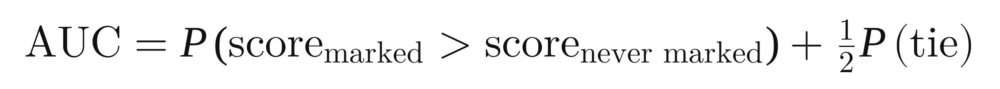


**โค้ด:** [metrics.auc (บรรทัด 50)](../src/svdmark/metrics.py#L50)

**ไฟล์ผลลัพธ์ที่เปิดให้ดูได้:** [results/findings.md](../results/findings.md), [results/watermark_detection.csv](../results/watermark_detection.csv), [results/pilot_decisions.md](../results/pilot_decisions.md)

> เลข 0.30 กับ 0.96 อ่านจาก [results/findings.md](../results/findings.md) บรรทัด 17 และ 20 ผมไม่ได้รันการทดลอง 400 รูปซ้ำ ก่อนพูดให้เปิดไฟล์นี้ดูตัวเลขอีกครั้ง

**ต่อไป:** ➡ ไม่ต้องเปิดไฟล์ใหม่ ไปปิดคลิป

---

## ฉาก 13: สรุปและข้อจำกัด (ประมาณ 1 นาที)

**เปิด:** [docs/MATH_MAP_TH.md](MATH_MAP_TH.md) (ตารางสูตรกับฟังก์ชัน)

**พูด:**
> สรุปคือ การซ่อนข้อความใช้ SVD ของแต่ละ block แล้วเก็บ bit ไว้ใน σ₁ ด้วยกฎ parity ของช่วง ตรวจซ้ำหลังปัดเศษพิกเซล ใช้ key ลับเลื่อนตารางช่วง ใช้ CRC ตรวจความถูกต้อง และใช้ Hamming(7,4) แก้ bit ที่ผิด ส่วนลายน้ำใช้วิธี Liu–Tan ผสมโลโก้เข้ากับ σ ของรูป และใช้คะแนน shift ตัดสินว่ามีลายน้ำจริงหรือไม่
>
> ข้อจำกัดที่เราวัดได้จริงมีสองข้อ หมุนรูปแม้เพียงครึ่งองศาทำให้ข้อความเสีย และ blur ทำให้ตัวตรวจลายน้ำพลาด ข้อมูลทั้งหมด สูตรกับฟังก์ชันที่ใช้ และสคริปต์ที่รันซ้ำได้ อยู่ใน GitHub ของโครงงาน ขอบคุณครับ/ค่ะ

---

## ตารางลัดสำหรับตัดต่อ: สูตร → บรรทัดโค้ด

| สูตร | วางคู่กับโค้ด |
|---|---|
| `A = U Σ Vᵀ` | [svd_utils.py#L13](../src/svdmark/svd_utils.py#L13) |
| `‖A‖_F² = Σ σᵢ²` | [svd_utils.py#L24](../src/svdmark/svd_utils.py#L24) |
| `σᵢ = √λᵢ(AᵀA)` | [svd_utils.py#L29](../src/svdmark/svd_utils.py#L29) |
| `PSNR = 10·log₁₀(255² / MSE)` | [metrics.py#L18](../src/svdmark/metrics.py#L18) |
| `NCC = ⟨w, w*⟩ / (‖w‖·‖w*‖)` | [metrics.py#L24](../src/svdmark/metrics.py#L24) |
| `q = ⌊σ/Δ⌋,  bit = q mod 2` | [stego.py#L33](../src/svdmark/stego.py#L33) |
| ย้าย σ ไปกลางช่วง `(q' + ½)·Δ` | [stego.py#L38](../src/svdmark/stego.py#L38) |
| capacity `⌊h/b⌋·⌊w/b⌋` | [stego.py#L66](../src/svdmark/stego.py#L66) |
| SVD ของทุก block และเลือกช่วง | [stego.py#L157](../src/svdmark/stego.py#L157) |
| ปัดเศษ + อ่านกลับ + margin `≥ 0.25·Δ` | [stego.py#L177](../src/svdmark/stego.py#L177) |
| key → `uᵢ` (PBKDF2) | [stego.py#L92](../src/svdmark/stego.py#L92) |
| frame length ∥ CRC ∥ text | [stego.py#L244](../src/svdmark/stego.py#L244) |
| `c = d·G mod 2,  s = H·rᵀ mod 2` | [ecc.py#L36](../src/svdmark/ecc.py#L36) |
| `D = S + α·W,  A_w = U·S_w·Vᵀ` | [watermark.py#L27](../src/svdmark/watermark.py#L27) |
| `W* = (D* − S) / α` | [watermark.py#L43](../src/svdmark/watermark.py#L43) |
| `shift = cos(σ* − S,  S_w − S)` | [watermark.py#L66](../src/svdmark/watermark.py#L66) |
| `AUC = P(score รูปที่ฝัง > score รูปที่ไม่เคยฝัง)` | [metrics.py#L50](../src/svdmark/metrics.py#L50) |
